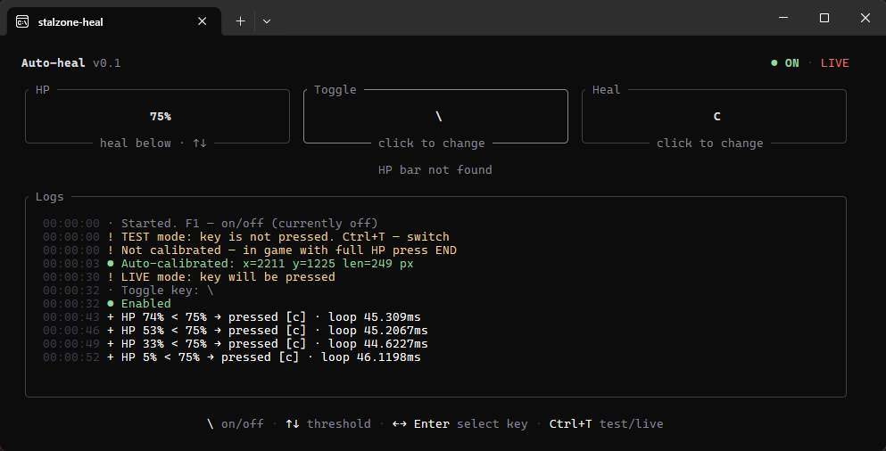

# stalzone-heal

Auto-heal for Stalzone. It watches the HP bar on screen and presses the medkit key when HP drops below a threshold. It doesn't touch game memory, it only reads pixels and sends key presses

Windows only. It works while the `stalzonew.exe` window is active. If the game is minimized or another window has focus, it doesn't read or press anything



## Quick start

1. Download the exe from the [releases page](https://github.com/ix1le/stalzone-heal/releases/latest), launch it and get into the game. In the game settings, set the screen mode to **Borderless Window (compatibility mode)**, otherwise the program can't see the HP bar
2. The program first tries to calibrate on its own, every 3 seconds. If it hasn't happened or you want to redo it, press **End** at full HP with the HUD visible (details below)
3. The program starts in **TEST** mode: it logs what it *would* press but doesn't press anything, so check that it triggers where it should
4. Press **Ctrl+T** to switch to LIVE
5. Press **F1** to enable it, it works in-game too

On/off state, mode and threshold are shown at the top of the window and in the HP box

## Controls

| What | How |
|---|---|
| On/off | F1 (global, changeable in the ini or by clicking the Toggle box) |
| Calibration | End in-game (global, only changeable in code) |
| HP threshold | ↑↓ (±1), PgUp/PgDn (±5), mouse wheel over the HP box |
| Change a key | Click the Toggle or Heal box, or use ←→/Tab and Enter, then press the key you want. Esc cancels |
| TEST / LIVE | Ctrl+T |
| On/off with the mouse | Click `● ON / ○ OFF` in the top right |
| Quit | Ctrl+Q or Ctrl+C |
| Open the update page | Click the `↑ vX.Y available` label in the top left |

Anything you change in the window (threshold, keys, mode) is written to `config.ini` right away

## Updates

On startup the program checks the latest GitHub release once, in the background. If a newer version exists, a yellow `↑ v0.2 available` label appears next to the title and a line is added to the log. Click the label to open the release page

If there's no internet or GitHub doesn't answer, nothing happens and the program works as usual. This is the only network request it makes

## Calibration

The program doesn't know in advance where your HP bar is, since resolution and HUD scale differ from person to person. So it finds the bar itself:

- It grabs a screen frame and looks in the bottom-right quarter for the long khaki stamina bar
- There should be a red bar above it, that's HP. The program remembers the left edge and length of the bar

You can calibrate in two ways:

- **Manually:** press **End** while you're in the game at full HP
- **Automatically:** if the program isn't calibrated yet, it tries on its own every 3 seconds while the game has focus

Things to know:

- Calibrate at **full HP**. If HP isn't full, the program finds the bar but doesn't save it and tells you in the log, because the length would come out wrong
- The result lives in `bar.ini` next to the exe and is tied to your screen size. If you change the resolution the calibration won't carry over, so press End again or delete `bar.ini` to reset
- Without calibration it uses rough coordinates for the bottom-right corner (scaled from the screen height), which isn't reliable
- It only looks at the **first monitor**, so the game has to be on that one
- If the screen capture comes out black or the bar isn't found, check the screen mode: the game must be in Borderless Window (compatibility mode)

## config.ini

Lives next to the exe and is created on first launch. Delete it to restore the defaults

**Important:** values are read at startup, so if you edit the ini by hand, restart the program. Don't edit it while the program is running, because any change in the window rewrites the whole file and wipes out your edits and comments

### [Keys]

| Setting | Default | What it does |
|---|---|---|
| `heal_key` | `c` | The medkit key. It can be a combo like `ctrl+c`, `shift+1` or `alt+f` |
| `toggle_key` | `f1` | The on/off key. It can't be the same as `heal_key` |

Letters, digits, F1–F12, `space`, `tab`, `` ` `` and `\` are supported, the `+` key isn't. The Russian layout doesn't get in the way: `с` and `c` are the same physical key

### [Healing]

| Setting | Default | What it does |
|---|---|---|
| `heal_below_percent` | `75` | Heal when HP is below this (1–99) |
| `cooldown_ms` | `3000` | Minimum pause between medkit presses |
| `dry_run` | `true` | `true` means log only, `false` means actually press |
| `fast_input` | `false` | `true` presses and releases right away with no pauses, `false` holds the key for about 40 ms |

Games poll input once per frame (about 16 ms at 60 FPS), so a press with no hold can slip between two polls and the game won't see it. If the medkit sometimes doesn't fire, set `fast_input` to `false`. If everything works reliably with `true`, keep whichever you prefer. With modifiers like `ctrl+c`, fast mode also has no pause between ctrl and the key, while a single key is less likely to have problems

Presses go through `SendInput` using scan codes, so the layout doesn't matter. If the game runs as administrator and the program doesn't, Windows may silently block the presses, so run the program as admin too

### [Confirmation]

Protection against one-off glitches where the bar dips for a single frame

| Setting | Default | What it does |
|---|---|---|
| `confirm_frames` | `2` | How many readings in a row HP must be below the threshold |
| `confirm_ms` | `120` | For how many ms in a row HP must stay below it (0 means don't check time) |

Both conditions must be met. Any reading that's above the threshold or has no bar resets the counter. Higher values are safer but heal later

### [Bar reading]

The HUD is semi-transparent, so red objects in the background (blood, lights, effects) can fool the reader. These settings help with that

| Setting | Default | What it does |
|---|---|---|
| `learn_ref` | `true` | Remembers the exact bar color at near-full HP and compares against it. `false` takes the color of the first two pixels of the bar instead |
| `gap_divisor` | `25` | Allowed gap inside the bar = length / this number. A higher number means a smaller gap, `0` means a fixed 2 pixels |
| `skip_suspect` | `true` | If there's a lot of foreign red on the bar, the frame is skipped instead of counted as low HP |

The reference color is reset and learned again if nothing can be read for 5 seconds in a row

### [Debug]

| Setting | Default | What it does |
|---|---|---|
| `debug_heal` | `false` | Adds the reference color, the bar's break point and the foreign pixel count to the heal log line, and also logs skipped frames |

If healing triggers at the wrong time, turn this on and watch the log

## If something doesn't work

- **The program doesn't see the HP bar at all:** it only works when the game's screen mode is **Borderless Window (compatibility mode)**. In any other mode (including exclusive fullscreen) it can't capture the HP bar. Change it in the game's graphics settings
- **"HP bar not found":** the game isn't in focus, the HUD is hidden, or the saved calibration doesn't fit. Press End at full HP
- **Healing triggers at full HP:** there's red background on the bar. Check that `skip_suspect` and `learn_ref` are on, then recalibrate with End
- **Healing doesn't trigger:** check that you're in LIVE, not TEST, and that the program is ON
- **Presses don't reach the game:** try `fast_input = false` and run as admin
- **The log shows "Frame skipped" (with `debug_heal`):** frames are being dropped because of the background, which is normal if it doesn't happen too often

## Building

Requires Rust 1.85+ (edition 2024)

```
cargo build --release
```

`on.wav` and `off.wav` must sit next to `main.rs`. They're embedded into the exe and play when you enable and disable the program

## Warning

The program automates actions in a game. If the game's rules forbid that, a ban is possible and the responsibility is yours